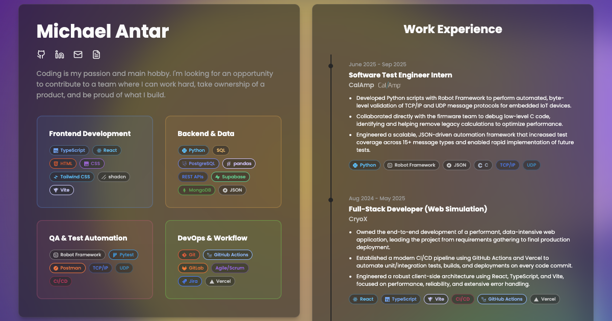

# Michael Antar - Personal Portfolio

A static, responsive, single-page portfolio for Michael Antar. The page is
handwritten HTML and CSS: no framework, no build step, no dependencies, and no
runtime JavaScript. It presents experience, projects, education, and skills and
deploys straight to GitHub Pages.



## Design

- **Theming**: follows the operating system light/dark preference with
  `prefers-color-scheme`; there is no theme toggle and no stored preference.
- **Typography**: the system UI font stack; no web fonts and no third-party font
  requests.
- **Layout**: a two-column desktop composition at `64rem` and wider, collapsing
  to one column in DOM order on smaller screens.
- **Interaction**: native anchors for navigation, native `<details>` for the
  project demo, and native video controls. Nothing autoplays.
- **Deployment**: GitHub Pages serves the `site/` directory directly.
- **Large files**: Git LFS tracks the demo videos in `site/assets/*.mp4`.

## Run Locally

No dependencies to install. Serve the publish root and open
`http://127.0.0.1:4173/`:

```sh
python3 -m http.server 4173 --directory site
```

## Deployment

Pushing to `main` or dispatching the **Deploy static content to Pages** workflow
manually publishes `site/` to GitHub Pages with `actions/deploy-pages`. There is
no build, install, or test step; the workflow uploads the `site/` directory
as-is.

The two demo videos are Git LFS objects. Run `git lfs pull` after cloning if they
arrive as pointer files.
